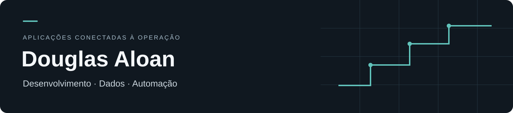

# Douglas Aloan

**Desenvolvimento de aplicações · Dados · Automação**

Atuo na construção e evolução de soluções que conectam a operação de uma empresa aos seus dados: dashboards, portais, CRM, integrações e atendimento com IA. Meu foco está em entender a regra de negócio, organizar a solução e validar o comportamento que chega ao usuário.

Minha experiência reúne frentes de desenvolvimento, análise de dados e sustentação de sistemas. A participação varia conforme o projeto, incluindo evolução de bases existentes, integrações, implementação e validação.

## Projetos e frentes de atuação

| Estudo de caso | Problema trabalhado | Recorte técnico |
| --- | --- | --- |
| [Dados comerciais e ERP](cases/01-dados-erp.md) | Transformar dados operacionais em consultas e indicadores úteis | SQL Server, Excel/ODBC, API Node.js, React |
| [CRM comercial e contas isoladas](cases/02-crm-comercial.md) | Reunir atendimento, carteira, agenda e documentos com acesso por conta | React, TypeScript, PostgreSQL, Supabase |
| [Atendimento com IA e continuidade humana](cases/03-atendimento-ia.md) | Manter contexto, controlar ações e permitir transferência para a equipe | Integrações, processamento de mensagens, testes e observabilidade |
| [Conteúdo e integrações de produtividade](cases/04-conteudo-integracoes.md) | Organizar análise de perfis, ideias e planejamento de conteúdo | Next.js, Prisma, PostgreSQL, OpenAI e Notion |
| [Operação e diagnóstico de sistemas](cases/05-operacao-diagnostico.md) | Investigar falhas entre aplicação, serviços, cache e infraestrutura | Windows Server, Nginx, APIs e documentação operacional |

Os estudos apresentam contexto, decisões técnicas e limites de cada entrega. Nomes e dados de clientes foram anonimizados; as bases operacionais permanecem privadas.

## Tecnologias presentes nos trabalhos

- **Aplicações:** TypeScript, React, Next.js, Vite, Node.js, Tailwind CSS e componentes reutilizáveis.
- **Dados:** SQL Server, PostgreSQL, Supabase, Prisma, Excel, ODBC, tratamento de dados e indicadores.
- **Integrações e IA:** APIs HTTP, webhooks, processamento de mensagens, serviços de IA e revisão humana.
- **Qualidade e operação:** Git, GitHub Actions, testes de regras de negócio, Docker, Nginx e investigação de incidentes.

## Como trabalho

Parto da regra de negócio e do fluxo real de uso. Procuro separar a interface da integração, preservar a origem dos dados e distinguir uma ausência de informação de um valor confirmado. Em automações, considero repetição de eventos, retomada após falha e autorização das ações. Na validação, diferencio demonstração, ambiente de teste e produção.

Tenho interesse em oportunidades que combinem desenvolvimento de sistemas, dados e automação de processos. Em uma conversa técnica, posso aprofundar as decisões e minha participação em cada frente, respeitando a confidencialidade dos projetos.

**Perfil:** [github.com/Douglas-Aloan](https://github.com/Douglas-Aloan)
